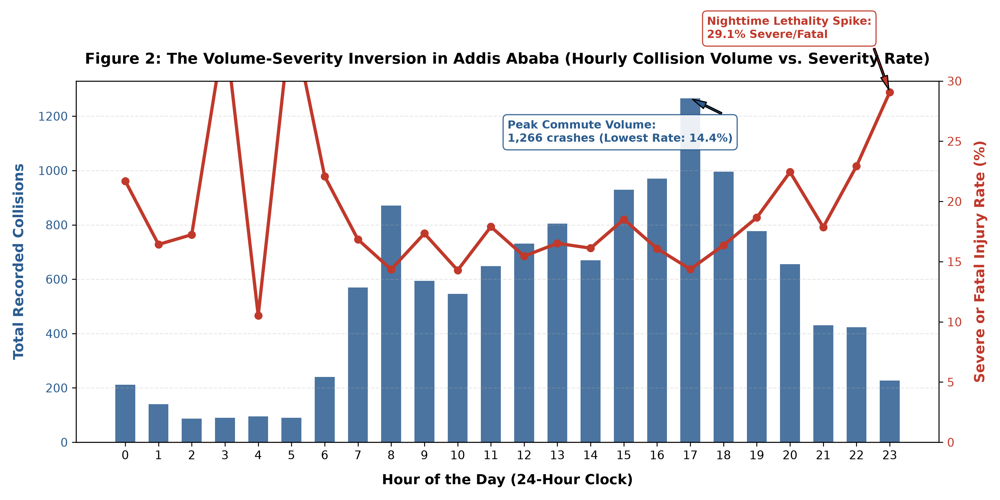
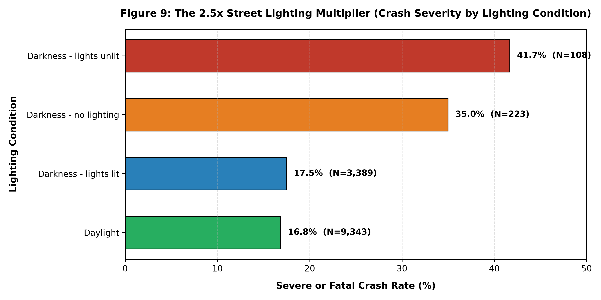
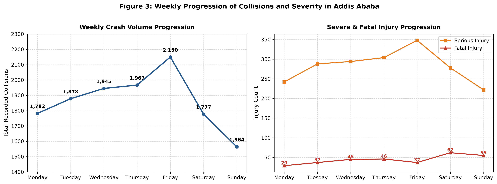
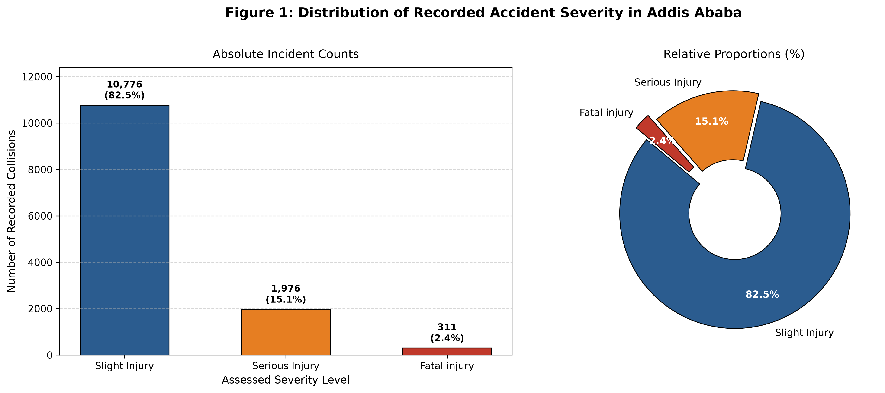

# Understanding and Trusting Road Accident Data: An Exploratory Analysis of Addis Ababa

[](https://www.python.org/)
[](#interactive-streamlit-web-dashboard)
[](#data-provenance)
[](https://git-scm.com/)
[](#curriculum-coverage)

A reproducible, evidence-based exploratory data science portfolio project analyzing **13,063 police-recorded traffic collisions** in Addis Ababa, Ethiopia.

---

## 🚦 Interactive Streamlit Web Dashboard

The project includes an executive-grade, real-time interactive web application built with Streamlit and Plotly:

```powershell
# Launch the dashboard locally
streamlit run app.py
```

### Dashboard Features:
- **Dynamic Multi-Parameter Filtering:** Filter 13,063 collisions in real-time by severity, day of week, hour range (0–23), lighting conditions, and vehicle categories.
- **Live Executive KPI Cards:** Real-time metrics calculating total collision volume, lethality rate (%), total casualties, and average vehicles involved.
- **5 Exploration Modules:**
  1. **Temporal Dynamics:** Dual-axis interactive Plotly charts tracking hourly volume vs. severe injury rate.
  2. **7x24 Density Heatmap:** Interactive heatmap of all 168 hours of the week.
  3. **Infrastructure Hazards:** The 2.5x Street Lighting multiplier and road surface friction breakdowns.
  4. **Vehicle & Casualty Dynamics:** Box plots and jittered scatter distributions.
  5. **Data Explorer & Export:** Interactive searchable table with one-click filtered CSV export.

---

## 1. Project Overview & Analytical Philosophy

Traffic collisions represent an urgent public health and urban mobility challenge in rapidly expanding metropolitan centers. This portfolio project investigates the quality, completeness, and observational patterns within the Addis Ababa road traffic accident dataset.

Rather than taking data at face value or calculating naive correlations, this analysis emphasizes **data trustworthiness**, separating observed crash volumes from actual individual risk by rigorously evaluating **exposure denominators**, missingness patterns, and reporting artifacts.

---

## 2. Key Empirical Findings

### 2.1. The Volume-Severity Inversion
- **Commuter Congestion Peak:** Total collision counts peak predictably during the late afternoon weekday rush hour (**17:00–18:00**, with **1,266 crashes** at 17:00).
- **Nighttime Lethality Spike:** While 17:00 records the highest crash volume, it exhibits the **lowest severe-injury rate (14.4%)**. Conversely, between **21:00 and 02:00**, the severe-injury rate surges above **21.7%**, with fatal crash counts more than doubling relative to vehicle exposure.

<p align="center">
  
</p>

### 2.2. The 2.5x Street Lighting Multiplier
Municipal lighting infrastructure plays a profound role in crash outcomes:
- **Daylight:** 16.8% severe or fatal injury rate.
- **Darkness with Lit Streetlights:** 17.5% severe or fatal injury rate.
- **Darkness with Unlit Streetlights:** **41.7% severe or fatal injury rate** (nearly **2.5 times higher** than daylight).
- **Darkness with No Streetlights:** **35.0% severe or fatal injury rate**.

<p align="center">
  
</p>

### 2.3. The Weekend Fatality Disparity
- **Friday** experiences the highest weekly volume (**2,150 collisions**), driven by end-of-week commercial traffic.
- **Saturday and Sunday**, despite lower overall traffic volume, record the highest raw fatality counts:
  - **Monday:** 29 fatalities (15.2% severe rate)
  - **Saturday:** **62 fatalities** (19.1% severe rate — more than double Monday)
  - **Sunday:** **55 fatalities** (17.7% severe rate)

<p align="center">
  
</p>

### 2.4. Target Class Imbalance
The police-recorded outcome variable (`Accident_severity`) exhibits severe skewness:
- **Slight Injury:** 10,776 (82.5%)
- **Serious Injury:** 1,976 (15.1%)
- **Fatal injury:** 311 (2.4%)

<p align="center">
  
</p>

---

## 3. Visualizations & Figures Showcase

| Figure | Description | Exported Asset |
| :--- | :--- | :--- |
| **Figure 1** | Absolute Counts & Proportions of Accident Severity | [`reports/figures/01_severity_distribution.png`](reports/figures/01_severity_distribution.png) |
| **Figure 2** | The Volume-Severity Inversion (Dual-Axis Static High-Res) | [`reports/figures/02_hourly_severity_trends.png`](reports/figures/02_hourly_severity_trends.png) |
| **Figure 2 (Interactive)** | Dual-Axis Hourly Volume vs. Severe Injury Rate (Interactive Plotly) | [`reports/figures/02_hourly_severity_interactive.html`](reports/figures/02_hourly_severity_interactive.html) |
| **Figure 3** | Day of Week Progression: Volume vs. Fatality Trends | [`reports/figures/03_day_of_week_trends.png`](reports/figures/03_day_of_week_trends.png) |
| **Figure 4** | Number of Vehicles Involved vs. Casualties (Jittered Scatter Plot) | [`reports/figures/04_vehicles_vs_casualties_scatter.png`](reports/figures/04_vehicles_vs_casualties_scatter.png) |
| **Figure 5** | Temporal Hotspot Heatmap (7 Days x 24 Hours) | [`reports/figures/05_temporal_hotspot_heatmap.png`](reports/figures/05_temporal_hotspot_heatmap.png) |
| **Figure 6** | Casualty Distributions Across Primary Vehicle Types (Box Plot) | [`reports/figures/06_vehicle_type_casualties_boxplot.png`](reports/figures/06_vehicle_type_casualties_boxplot.png) |
| **Figure 7** | Kernel Density of Casualties Across Severity Levels (Violin Plot) | [`reports/figures/07_severity_casualties_violinplot.png`](reports/figures/07_severity_casualties_violinplot.png) |
| **Figure 8** | Multivariate Pair Plot (KDEs & Stratified Bivariate Scatters) | [`reports/figures/08_multivariate_pairplot.png`](reports/figures/08_multivariate_pairplot.png) |
| **Figure 9** | The 2.5x Street Lighting Hazard Multiplier | [`reports/figures/09_lighting_conditions_severity.png`](reports/figures/09_lighting_conditions_severity.png) |
| **Automated EDA** | Full Automated Profiling Dashboard (Standalone HTML) | [`reports/road_accident_eda_report.html`](reports/road_accident_eda_report.html) |
| **Web Dashboard** | Real-Time Interactive Streamlit Intelligence Application | [`app.py`](app.py) |

---

## 4. Repository Structure

```text
Addis-Ababa-Road-Safety-Analysis/
├── Data/                 # Addis Ababa police collision records (13,063 records)
├── docs/
│   └── data_dictionary.md # Comprehensive 31-column data dictionary
├── notebooks/
│   ├── 01_dataset_understanding.ipynb    # Structural schema and dimensions
│   ├── 02_data_quality_audit.ipynb       # Missingness, outliers, and data hygiene
│   ├── 03_exploratory_data_analysis.ipynb# Full ALX Module 1 visualization suite
│   └── 04_automated_eda.ipynb            # Automated profiling and verification
├── reports/
│   ├── figures/                          # Exported high-resolution figures (PNG & HTML)
│   ├── findings_report.md                # Publication-grade executive road safety report with embedded charts
│   └── road_accident_eda_report.html     # Automated HTML profile report
├── src/
│   └── profiling.py                      # Reusable automated EDA profiling engine
├── app.py                                # Interactive Streamlit dashboard web application
├── .gitignore                            # Exclusion rules for virtual environments
├── requirements.txt                      # Project dependency specification
└── README.md                             # Project overview and reproduction guide
```

---

## 5. Reproduction & Setup Instructions

To reproduce all findings, figures, and launch the dynamic web dashboard in a clean environment:

### 5.1. Clone Repository & Setup Virtual Environment
```powershell
git clone https://github.com/YonInsights/Addis-Ababa-Road-Safety-Analysis.git
cd Addis-Ababa-Road-Safety-Analysis

# Create and activate isolated virtual environment
python -m venv .venv
Set-ExecutionPolicy -Scope Process -ExecutionPolicy Bypass
.\.venv\Scripts\Activate.ps1
```

### 5.2. Install Dependencies
```powershell
pip install -r requirements.txt
```

### 5.3. Launch the Web Dashboard
```powershell
streamlit run app.py
```

### 5.4. Register Jupyter Kernel
```powershell
python -m ipykernel install --user --name addis-ababa-road-safety --display-name "Python (Addis Ababa Road Safety)"
```

---

## 6. Author & Attribution

- **Author:** YonInsights
- **Email:** `yo2120018@gmail.com`
- **GitHub:** [YonInsights](https://github.com/YonInsights)
