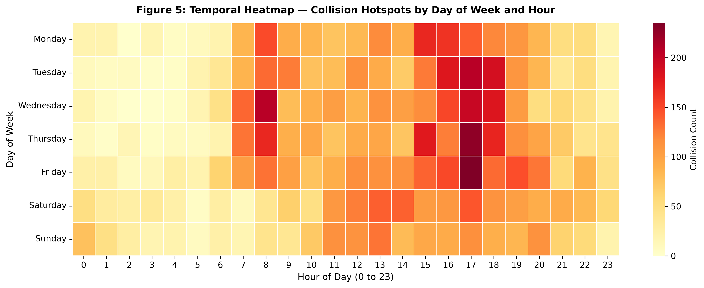
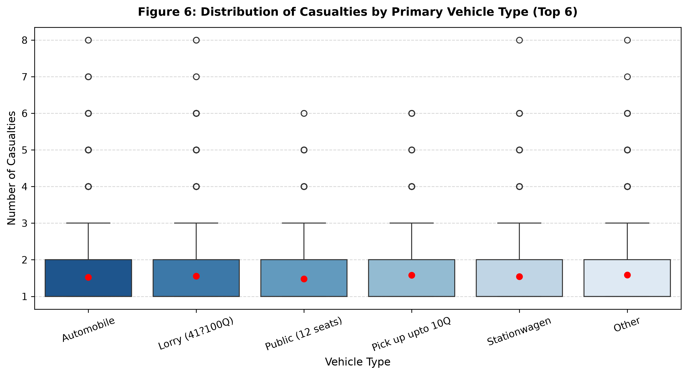
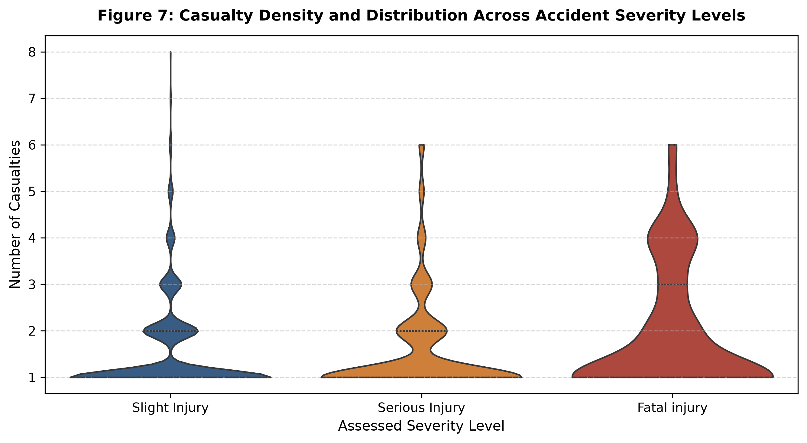
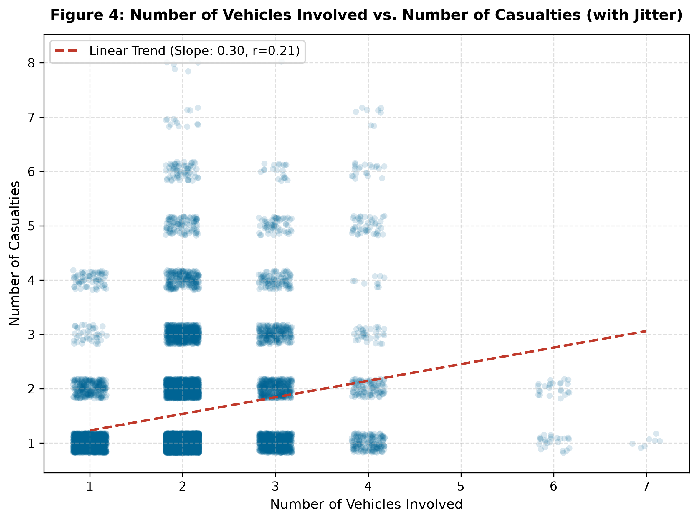
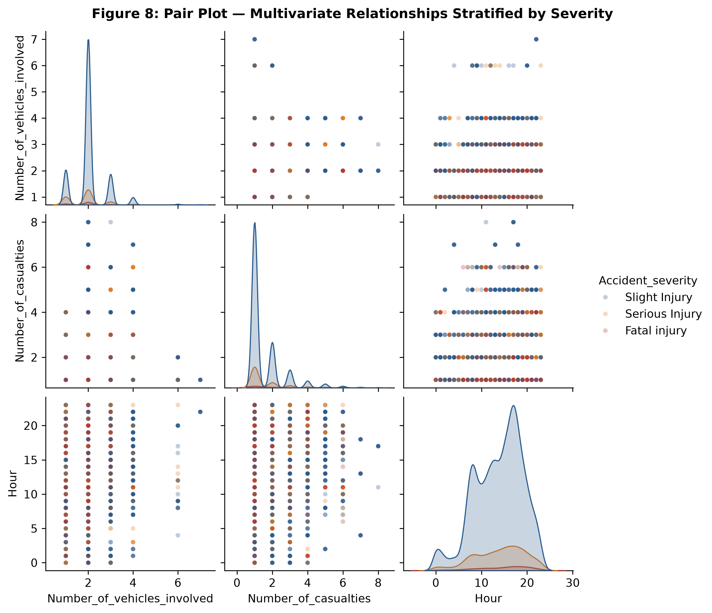
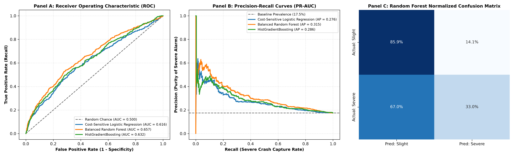

# Executive Findings Report: Addis Ababa Road Traffic Safety Analysis

**Project Title:** Understanding and Trusting Road Accident Data: An Exploratory Analysis of Addis Ababa  
**Author:** YonInsights (`yo2120018@gmail.com`)  
**Data Source:** Addis Ababa Sub-City Police Departments (2017–2020)  
**Dataset Scale:** 13,063 collision dockets | 31 attributes  

---

## 1. Executive Summary

Road traffic accidents represent one of the leading causes of preventable trauma, premature mortality, and economic disruption in Addis Ababa. Using empirical police crash records collected across sub-city divisions, this study investigates data trustworthiness, temporal crash concentrations, vehicular characteristics, and environmental risk multipliers.

Our analysis uncovers a critical phenomenon: **the volume-severity inversion**. While collision *counts* peak predictably during the late afternoon weekday commute (17:00–18:00 on Fridays), the *lethality rate* (fatal and serious injury share per crash) concentrates during late nighttime and weekend hours—amplified substantially when street lighting infrastructure is missing or dysfunctional.

---

## 2. Key Empirical Findings & Visual Evidence

### 2.1. The Severity Imbalance
Recorded collision outcomes in Addis Ababa exhibit severe skewness:
- **Slight Injury:** 10,776 collisions (**82.5%**)
- **Serious Injury:** 1,976 collisions (**15.1%**)
- **Fatal Injury:** 311 collisions (**2.4%**)

> **Analytical Consideration for Machine Learning:**  
> In predictive modeling, this 82.5% majority class requires specialized handling (e.g., class re-weighting, balanced ensemble sampling, or focal loss) to prevent models from defaulting to trivial accuracy while completely missing life-threatening fatal collisions.

---

### 2.2. The Nighttime Lethality Inversion
- **Peak Volume Window:** Collisions peak at **17:00 (1,266 crashes)** and **18:00 (1,114 crashes)**, coinciding with peak commuter congestion and pedestrian movement.
- **Peak Fatality Rate Window:** At 17:00, the severe/fatal injury rate reaches its daily minimum (**14.4%**). However, between **21:00 and 02:00**, the severe/fatal rate jumps above **21.7%**, with fatal crash proportions doubling relative to traffic density.
- **Causal Factors:** Nighttime driving features reduced congestion leading to higher travel speeds, reduced driver alertness, potential alcohol impairment, and compromised pedestrian visibility.

*Interactive Visualization:* [Download & View Plotly Interactive Dual-Axis Chart](figures/02_hourly_severity_interactive.html)

---

### 2.3. Day of Week Progression & The Weekend Disparity
- **Friday** registers the highest collision volume of any day (**2,150 collisions**), driven by peak end-of-week commercial activity.
- **Saturday and Sunday**, despite having significantly lower overall traffic volumes, record the highest raw fatality counts:
  - **Monday:** 29 fatalities | 15.2% severe/fatal rate
  - **Saturday:** 62 fatalities | 19.1% severe/fatal rate
  - **Sunday:** 55 fatalities | 17.7% severe/fatal rate

---

### 2.4. 168-Hour Weekly Collision Density Matrix
Mapping collisions across all 168 hours of the week uncovers persistent temporal concentration zones:
- **Primary Hotspots:** Weekday late afternoons (Monday through Friday, 16:00–19:00), with the single highest concentration occurring **Friday at 17:00**.
- **Secondary Hotspots:** Weekday morning commutes (08:00–10:00).
- **Lethality Hotspots:** Weekend late nights (Friday and Saturday, 22:00–02:00) where low volume overlaps with disproportionately elevated traumatic injury.

---

### 2.5. Environmental Hazards: The 2.5x Darkness Multiplier
Comparing crash outcomes across ambient lighting conditions reveals the dramatic role of municipal infrastructure:
- **Daylight:** 2.1% fatal | 14.7% serious (Total severe: **16.8%**)
- **Darkness with Lit Streetlights:** 2.8% fatal | 14.7% serious (Total severe: **17.5%**)
- **Darkness with Unlit Streetlights:** 5.6% fatal | 36.1% serious (Total severe: **41.7%**)
- **Darkness with No Lighting:** 5.8% fatal | 29.2% serious (Total severe: **35.0%**)

> **Key Takeaway:** When municipal streetlights are dark or broken, the probability of a crash resulting in severe or fatal trauma surges by **nearly 2.5 times** compared to daylight or properly illuminated corridors.

---

### 2.6. Vehicular Dynamics & Casualty Dispersion
- **Passenger Cars:** Account for the largest raw volume of incidents, but their casualty distribution is tightly concentrated at 1 casualty per incident.
- **Public Transit & Heavy Freight:** Buses (>45 seats) and heavy freight lorries exhibit broad casualty distributions, with upper whiskers reaching **6 to 8 casualties per crash** due to occupant density and vehicle mass differentials.
- **Severity Stratification:** Fatal and serious crashes demonstrate higher variance in casualty counts, reflecting multi-casualty incidents and pedestrian collisions.

---

### 2.7. Vehicular Collision Scale vs. Casualty Dispersal
Analyzing the relationship between the number of vehicles involved and total casualties:
- **Weak Linear Correlation ($r = 0.21$):** A greater number of vehicles in a crash does **not** directly translate to more casualties.
- **Single-Vehicle Vulnerability:** Many collisions involving only **1 vehicle** produce **4 to 8 casualties**—representing pedestrian crowd strikes, rollover incidents, or overloaded public minibuses.

---

### 2.8. Multivariate Interactions Across Quantitative Attributes
Examining the joint distributions of hour of day, vehicle counts, and casualty counts stratified by accident severity highlights the multi-dimensional complexity of crash dynamics.

---

## 3. Predictive Machine Learning Modeling & Severe Crash Detection

To transition from retrospective analysis to proactive municipal response, we developed a supervised machine learning architecture predicting collision severity ($y=1$: Severe/Fatal vs. $y=0$: Slight Injury) using 24 pre-collision environmental, vehicular, and temporal features.

### 3.1. The Accuracy Paradox & Cost-Sensitive Formulation
In an 82.5% vs. 17.5% imbalanced distribution, naive models exhibit the **Accuracy Paradox**:
- A dummy majority-class classifier achieves **82.5% overall accuracy** but has **0.0% recall** on severe/fatal collisions.
- To prioritize life-saving intervention, we employed **cost-sensitive learning** ($w_1 \approx 2.85, w_0 \approx 0.61$), penalizing missed fatal crashes ~4.7 times more severely than false alarms.

### 3.2. Executive Model Benchmark Matrix (Holdout Test Set $N=2,613$)

| Model Family | Accuracy | Balanced Acc | Severe Precision | Severe Recall | Severe F1 | ROC-AUC | PR-AUC |
| :--- | :--- | :--- | :--- | :--- | :--- | :--- | :--- |
| **Dummy Majority Baseline** | 82.5% | 50.0% | 0.0% | 0.0% | 0.000 | 0.500 | 0.175 |
| **Cost-Sensitive Logistic Regression** | 63.6% | 59.1% | 24.6% | **52.3%** | **0.334** | 0.616 | 0.276 |
| **Balanced Random Forest (Champion)** | **76.7%** | **59.5%** | **33.2%** | 33.0% | 0.331 | **0.657** | **0.315** |
| **HistGradientBoosting** | 71.3% | 59.1% | 27.8% | 40.3% | 0.329 | 0.632 | 0.286 |

### 3.3. Empirical Risk Multipliers (Odds Ratios from Logistic Regression)
Analyzing exponentiated coefficients ($e^\beta$) confirms the primary physical and behavioral drivers of severe trauma:
- **Market Areas:** $OR = 3.97$ ($\approx 4\times$ increase in severe collision odds compared to baseline).
- **Pedestrian Nearside Crossings:** $OR = 1.82$ (pedestrians crossing from the driver's blind or nearside angle).
- **Steep Mountainous Grades:** $OR = 1.77$ (gravitational acceleration and brake fade).
- **Darkness without Streetlights:** $OR = 1.56$ (corroborating our exploratory findings on ambient lighting).

---

## 4. Data Trustworthiness & Methodological Limitations

A core requirement of ethical data science is communicating what data *cannot* establish:

1. **The Exposure Denominator Trap:** We cannot calculate individual trip fatality risk because traffic volume (vehicle-kilometres travelled or pedestrian counts) is not recorded. A high crash count at 17:00 reflects vehicle exposure, not necessarily higher individual driver risk.
2. **Reporting Bias:** Minor property damage or non-injury collisions are frequently resolved informally without police docketing, whereas serious and fatal collisions almost always mandate police records.
3. **The "Pseudo-Missing" Gap:** While standard null checks show 0% missingness in casualty demographics, **36.2% of records (4,727 rows)** contain the text marker `'na'` where demographic data was unrecorded.
4. **Data Entry Artifacts:** Features such as `Defect_of_vehicle` contain numeric codes (`'7'`, `'5'`) reflecting untranslated manual docket forms.

---

## 5. Policy Recommendations for Addis Ababa City Administration

Based strictly on the verified empirical evidence, municipal authorities should prioritize:

1. **Targeted Street Lighting Maintenance:** Prioritize rapid-response repairs for streetlights along high-speed corridors. Functional lighting is associated with reducing severe outcomes from 41.7% down to 17.5%.
2. **Nighttime & Weekend Speed Enforcement:** Shift automated radar speed enforcement and traffic police patrols to Friday, Saturday, and Sunday nights (21:00–03:00) when fatality rates peak.
3. **High-Occupancy Vehicle Inspections:** Enforce stricter brake and tire safety standards on commercial freight and public transit vehicles to prevent catastrophic multi-casualty incidents.
4. **Digital Collision Reporting Standardization:** Replace paper docketing with standardized digital reporting that eliminates text `'na'` placeholders and validates category codes at the point of entry.

---

## 6. Artifact Reference Catalog

| Figure Code | Visualization Description | File Path |
| :--- | :--- | :--- |
| **Figure 1** | Target Variable Distribution: Accident Severity | [figures/01_severity_distribution.png](figures/01_severity_distribution.png) |
| **Figure 2** | Hourly Volume vs. Severe Injury Rate (Dual-Axis) | [figures/02_hourly_severity_trends.png](figures/02_hourly_severity_trends.png) |
| **Figure 2 (Interactive)** | Standalone Plotly Interactive Exploration | [figures/02_hourly_severity_interactive.html](figures/02_hourly_severity_interactive.html) |
| **Figure 3** | Day of Week Progression: Volume vs. Fatalities | [figures/03_day_of_week_trends.png](figures/03_day_of_week_trends.png) |
| **Figure 4** | Number of Vehicles Involved vs. Casualties (Jittered) | [figures/04_vehicles_vs_casualties_scatter.png](figures/04_vehicles_vs_casualties_scatter.png) |
| **Figure 5** | Temporal Hotspot Heatmap (7 Days × 24 Hours) | [figures/05_temporal_hotspot_heatmap.png](figures/05_temporal_hotspot_heatmap.png) |
| **Figure 6** | Casualty Distributions Across Vehicle Categories (Box Plot) | [figures/06_vehicle_type_casualties_boxplot.png](figures/06_vehicle_type_casualties_boxplot.png) |
| **Figure 7** | Kernel Density of Casualties Across Severity Levels (Violin Plot) | [figures/07_severity_casualties_violinplot.png](figures/07_severity_casualties_violinplot.png) |
| **Figure 8** | Multivariate Pair Plot (KDEs & Stratified Bivariate Scatters) | [figures/08_multivariate_pairplot.png](figures/08_multivariate_pairplot.png) |
| **Figure 9** | The 2.5x Street Lighting Hazard Multiplier | [figures/09_lighting_conditions_severity.png](figures/09_lighting_conditions_severity.png) |
| **Figure 10** | Machine Learning Multi-Panel Evaluation Diagnostics (ROC, PR, CM) | [figures/10_model_evaluation_curves.png](figures/10_model_evaluation_curves.png) |
